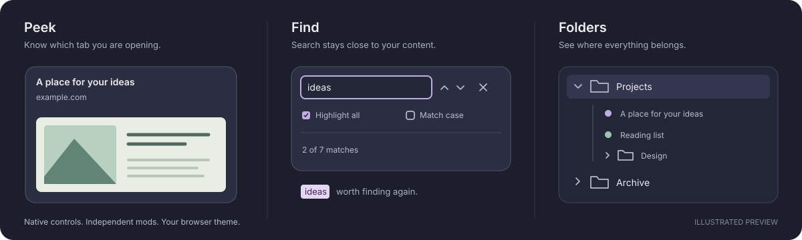

<div align="center">

# Zen Little Things

A little more clarity for your everyday browsing.

**Tab previews · Page search · Sidebar folders**

[Download ZIP](https://github.com/Vovcheese/zen-little-things/archive/refs/heads/main.zip) · [Installation help](docs/INSTALLATION.md) · [Report a bug](https://github.com/Vovcheese/zen-little-things/issues/new/choose)



<sub>Design illustration — not a browser screenshot.</sub>

</div>

## Pick what you need

| Mod | What you get |
| :--- | :--- |
| **[Peek](mods/zen-peek)** | An opaque tab preview with a readable title, domain, and page thumbnail. |
| **[Find](mods/zen-find)** | A tidy search panel at the top right. Use the familiar ⌘F / Ctrl+F shortcut. |
| **[Folders](mods/zen-folders)** | Clearer expand arrows, folder rows, and guides for nested tabs. |

Use one or all three. Each has its own switch in **Settings → Zen Mods**.

## Install on macOS

You need **Zen Browser** and **Python 3.9+** (`python3 --version` to check).

1. **[Download the ZIP](https://github.com/Vovcheese/zen-little-things/archive/refs/heads/main.zip)** and extract it.
2. Quit Zen completely with **⌘Q**.
3. Open **`install.command`** in the extracted folder and choose your mods.
4. Reopen Zen. Your mods appear in **Settings → Zen Mods**.

For **Peek**, open `about:config` and set these two preferences to `true`:

- `browser.tabs.hoverPreview.enabled`
- `browser.tabs.hoverPreview.showThumbnails`

Then hover another loaded tab to see its preview.

**Finder won't open the installer?** Open Terminal, type `cd `, drag the extracted folder into Terminal, press Return, then run:

```sh
zsh install.command
```

The default install keeps your search colors and preferences. The menu offers optional match colors separately. No pip packages are needed.

## Update or remove

**Update:** download the latest ZIP, quit Zen, and run `install.command` again. Existing mod switches and search preferences are preserved.

**Disable or remove:** use **Settings → Zen Mods**. If you enabled the optional search colors, choose **6** in the installer to restore your previous settings.

[Full installation guide](docs/INSTALLATION.md) · [Manual CSS / Windows / Linux](docs/INSTALLATION.md#manual-css-installation)

## Before you install

This is an **experimental community project**, not an official Zen release or a marketplace listing. The local installer supports macOS and one default Zen profile; it backs up files before changing them.

Developed against **Zen 1.23.2b on macOS**. Native checks cover Peek's light text-only card and Find's layout and next/previous navigation. Folders, other platforms, and older Zen releases are not fully verified. [See the testing status](tests/README.md).

## More

[What's new](CHANGELOG.md) · [Contributing](CONTRIBUTING.md) · [MIT license](LICENSE) · [Credits](docs/THIRD_PARTY.md)
